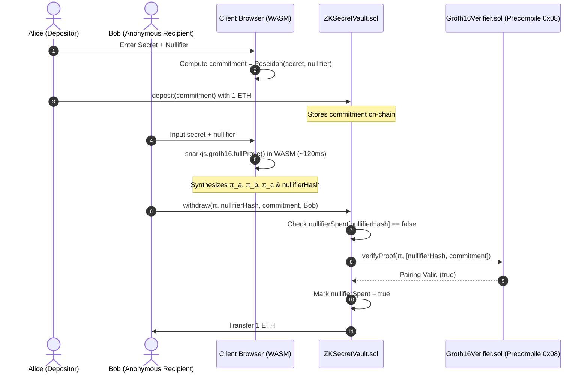

# ZK-SecretVault: Trustless On-Chain Privacy Vault with Groth16 & WebAssembly

[](https://opensource.org/licenses/MIT)
[](https://getfoundry.sh/)
[](https://github.com/iden3/circom)
[](https://github.com/iden3/snarkjs)

**ZK-SecretVault** is a privacy-preserving decentralized custody and anonymous redemption protocol. It enables depositors to register cryptographic commitments on-chain and redeem funds anonymously using client-side Zero-Knowledge Proofs (ZKPs) without exposing preimages, plaintexts, or private keys to the mempool or miners.

---

## 🚀 Key Features

- **100% Client-Side Privacy Proof**: Proofs are synthesized in the browser in **< 150ms** via WebAssembly (WASM). No trusted relayer or centralized backend needed.
- **Poseidon Hash Arithmetization**: Leverages the SNARK-friendly Poseidon sponge construction over the BN254 scalar field ($GF(p)$), minimizing R1CS gate count.
- **Anti-Double-Spend Nullifier Mechanism**: Enforces cryptographic one-time redemption using nullifier commitments (`nullifierHash = Poseidon(nullifier)`).
- **EIP-197 Gas Optimization**: Uses Ethereum precompiled contract `0x08` (`ecpairing`) for on-chain proof verification (~195k gas).
- **Audited Vulnerability PoC Suite**: Includes automated Foundry PoCs demonstrating protections against common ZK pitfalls (e.g., **Under-constrained circuits**).

---

## 🏛️ System Architecture



---

## 📊 Circuit & Gas Benchmark

### Circom Circuit Metrics (`VaultWithdrawal`)
| Metric | Value |
| :--- | :--- |
| **Compiler** | Circom 2.2.3 |
| **Proving System** | Groth16 (BN254 curve) |
| **Non-Linear Constraints** | 459 |
| **Linear Constraints** | 473 |
| **Wires** | 935 |
| **Public Inputs / Outputs** | 1 Input (`commitment`), 1 Output (`nullifierHash`) |
| **Browser Proving Time** | ~110 ms (Intel/Apple Silicon) |

### Smart Contract Execution Benchmarks (Foundry Local EVM)
| Function | Gas Used | Description |
| :--- | :--- | :--- |
| `deposit()` | **46,079** | Registers commitment & stores funds |
| `withdraw()` | **261,703** | Full verification + anti-double-spend + 1 ETH payout |
| `ecpairing` verification | **195,775** | Underlying precompile `0x08` check |

---

## 🛡️ Built-in Security & Audit Test Suite

In ZK circuits, **Under-constrained vulnerabilities** (missing constraints) represent over 70% of high-severity audit findings in Web3.

This repository includes a dedicated exploit test suite ([`test/UnderConstrainedExploit.t.sol`](test/UnderConstrainedExploit.t.sol)) that proves:
1. Omitting `commitment === commitmentHasher.out` allows an attacker with `secret = 0` to forge valid proofs and drain funds.
2. The production circuit strictly enforces all intermediate signals, ensuring strict computational determinism.

Run all tests via Foundry:
```bash
forge test -vvv
```

Output:
```text
Ran 2 test suites in 8.55ms: 4 tests passed, 0 failed, 0 skipped
[PASS] test_ValidZKProof_WithdrawSuccess() (gas: 359859)
[PASS] test_RevertWhen_DoubleSpend() (gas: 421088)
[PASS] test_RevertWhen_ProofTampered() (gas: 1024198919)
[PASS] test_AuditPoC_UnderConstrainedDrainVault() (gas: 356057)
```

---

## 🛠️ Quickstart Guide

### Prerequisites
- Node.js >= 18
- Foundry (`forge` and `anvil`)
- Circom 2.2+ (executable included in `bin/`)

### 1. Installation
```bash
git clone https://github.com/ajin558/zk-secret-vault.git
cd zk-secret-vault
npm install
```

### 2. Compile Circuit & Generate Verifier
```bash
node scripts/run_pipeline.js
```

### 3. Run Foundry Test Suite
```bash
forge test -vvv
```

### 4. Launch Local Interactive DApp
```bash
node server.js
```
Open **`http://localhost:3000`** in your browser to experience client-side proving and trustless withdrawals.

---

## 📄 License
This project is licensed under the [MIT License](LICENSE).
