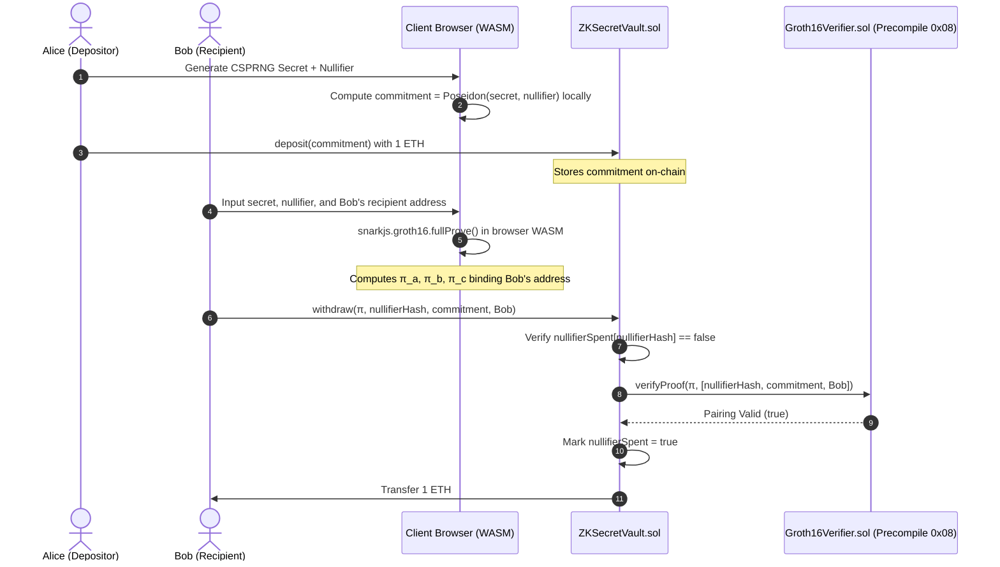

# ZK-SecretVault: Educational Zero-Knowledge Secret Vault Prototype

> [!WARNING]
> **EDUCATIONAL & EXPERIMENTAL PROTOTYPE ONLY**
> This repository is a pedagogical reference demonstrating the mechanics of Zero-Knowledge circuits (Groth16), smart contract verifiers, and client-side WebAssembly proving.
> - **Trusted Setup Disclaimer**: The Groth16 parameters in this repository were generated using local deterministic entropy. It provides **NO cryptographic security guarantees** against parties who can reconstruct the toxic waste. **NEVER deploy this codebase on mainnet with real user funds.**
> - **Anonymity Model**: Current implementation operates as a 1-to-1 zero-knowledge secret voucher (pairwise commitment). True multi-party anonymity pooling requires an incremental Merkle Tree accumulator (planned for Phase 2).

[](LICENSE)
[](https://getfoundry.sh/)
[](https://github.com/iden3/circom)
[](https://github.com/iden3/snarkjs)

---

## 📖 Overview

**ZK-SecretVault** demonstrates how to build a trustless on-chain deposit and redemption flow where:
1. Depositors register a cryptographic commitment on-chain: $\text{commitment} = \text{Poseidon}(\text{secret}, \text{nullifier})$.
2. The user generates a Groth16 zero-knowledge proof in the browser locally using WebAssembly.
3. The smart contract validates the proof via Ethereum precompile `0x08` (`ecpairing`) and releases funds.
4. **Anti-Frontrunning Protection**: The recipient address is cryptographically bound into the circuit constraints, preventing miners or MEV bots from stealing funds in the mempool.
5. **Anti-Double-Spend**: A public nullifier hash is tracked on-chain to prevent replay attacks.

---

## 🏛️ System Architecture



---

## 🛡️ Security Features & Audit Demonstrations

### 1. Mempool Front-Running Prevention (P0 Fixed)
In naive ZK implementations, the recipient address is merely passed to the smart contract without being enforced inside the zero-knowledge proof. A malicious observer in the public mempool can copy the valid proof parameters and replace `recipient` with their own address to steal funds.

In ZK-SecretVault, `recipient` is a public input to `VaultWithdrawal()` and enforced via an R1CS constraint:
```circom
signal recipientSquare;
recipientSquare <== recipient * recipient;
```
If an attacker attempts to substitute the recipient address, the pairing equation check fails immediately on-chain. Verified in `test_RevertWhen_FrontRunDifferentRecipient()`.

### 2. Under-Constrained Circuit Vulnerability PoC
This repository includes a dedicated security audit demonstration in [`audit_demo/`](audit_demo/):
- [`audit_demo/vulnerable_vault.circom`](audit_demo/vulnerable_vault.circom): Replicates a real-world bug where `commitment === commitmentHasher.out` is omitted.
- [`test/UnderConstrainedExploit.t.sol`](test/UnderConstrainedExploit.t.sol): Proves that an attacker with `secret = 0` can forge proofs and drain victim deposits.

---

## 📊 Benchmark & Gas Metrics

### Circuit Metrics (`circuits/vault.circom`)
- **Compiler**: Circom 2.2.3 (Circuit pragma `2.1.6+`)
- **Proving System**: Groth16 over BN254 curve
- **Non-Linear Constraints**: 460
- **Linear Constraints**: 473
- **Public Inputs / Outputs**: 1 Output (`nullifierHash`), 2 Inputs (`commitment`, `recipient`)
- **Wires**: 937

### Smart Contract Execution Benchmarks (Foundry 1.8.1)
| Function | Gas Used (Median) | Description |
| :--- | :--- | :--- |
| `deposit()` | **46,079** | Stores commitment and accepts 1 ETH |
| `withdraw()` | **284,820** | Reentrancy check + verification + nullifier marking + transfer |
| `verifyProof()` | **202,422** | Precompile `0x08` (`ecpairing`) check |

*(Note: In negative test cases such as `test_RevertWhen_ProofTampered`, Foundry test runner records full block gas exhaustion before precompile 0x08 pairing rejection, yielding the nominal ~1B gas figure reported in test traces).*

---

## 🛠️ Quickstart Guide

### Prerequisites
- Node.js >= 18
- Foundry (`forge` and `anvil`)
> **Zero Setup Required**: Pre-generated demo proving artifacts are included in `build/` and `frontend/circuit/` so you can run `forge test` and launch the local DApp immediately upon cloning. If you want to re-compile from source, `scripts/run_pipeline.js` will automatically detect your OS (Windows, macOS, Linux) and download the official Circom release binary on the fly.

### 1. Clone & Install
```bash
git clone https://github.com/ajin558/zk-secret-vault.git
cd zk-secret-vault
npm install
```

### 2. Run Foundry Tests (Instant Out-of-the-box Verification)
```bash
forge test -vvv
# or
npm test
```
*All 5 tests (including the UnderConstrained exploit PoC and front-running regression check) will pass in <15ms.*

### 3. Re-compile Circuit & Regenerate Keys (Optional)
```bash
npm run build:circuit
```
*Automatically checks or downloads the official Circom compiler, executes the Groth16 ceremony, exports `Verifier.sol`, and runs off-chain proofs.*

### 4. Run Interactive Local DApp
```bash
npm start
```
Open **`http://localhost:3000`** to interact with the local WebAssembly proving interface.

---

## 📄 License
This project is licensed under the [GNU General Public License v3.0](LICENSE) (aligned with dependencies including SnarkJS verifiers and circomlibjs).
